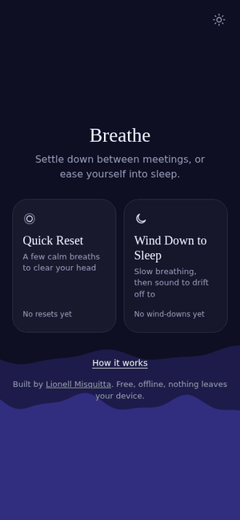

# Breathe

**A calm minute between meetings, or a gentle way into sleep.**
Free. Offline. No account. Nothing leaves your device.

**Open it:** https://lionellmisquitta.github.io/breathe/

[▶ Watch the full 38-second demo](https://lionellmisquitta.github.io/breathe/media/breathe-demo.mp4)

## Support Breathe

Breathe is free, and always intended to be. If it helped you slow down for a moment, you can support its continued development.

*GitHub Sponsors is currently pending approval, so sponsorships may not be available yet.*

---

## Guided breathing and mindful relaxation

Breathe is a free, privacy-friendly breathing and mindfulness app for taking a quick reset, relaxing after a stressful day, or winding down before sleep. Try guided breathwork using the physiological sigh, with optional waves, rain, or silence. No account or tracking required, and it works offline after your first visit.

## Two modes

**Quick Reset.** For between meetings. Pick 1, 3, 5 minutes or your own time, choose waves, rain or silence, and follow the circle as it fills with water.

**Wind Down to Sleep.** For bedtime. Breathe slowly for 3 or 5 minutes, then the sound keeps playing for 15, 25, 45 minutes or your own time and fades to silence. You can lock your phone.

## How the breathing works

Breathe is based on the **physiological sigh**: a slow breath in through the nose, a short second top-up, a brief pause, then a long, slow breath out through the mouth. Stanford research found that a few minutes a day of this kind of breathing improved mood, and Dr. Andrew Huberman has explained it widely.

The sound of water is there on purpose too. Marine biologist Dr. Wallace J. Nichols called the calm many of us feel near water **Blue Mind**.

If you feel light-headed, stop and breathe normally.

## Use it like an app on your phone

- **iPhone:** open the link in Safari, tap Share, then *Add to Home Screen*.
- **Android:** open the link in Chrome, tap the menu, then *Add to Home screen*.

After the first visit it works without internet.

## Private by design

No sign-up, no tracking, no servers. Your minutes and settings are saved only on your own device.

## Built by

**Lionell Misquitta** — [lionellmisquitta.com](https://lionellmisquitta.com)

## Credits and licences

- **Code:** MIT licence (see `LICENSE`).
- **Sea and rain recordings:** from [Mixkit](https://mixkit.co), used under the Mixkit Licence. They are not covered by the MIT licence; see Mixkit's terms before reusing them elsewhere.
- **Breathing technique:** the physiological sigh, as explained by Dr. Andrew Huberman. **Blue Mind:** Dr. Wallace J. Nichols. Breathe is not affiliated with or endorsed by either.

Breathe is a relaxation tool, not medical advice.
